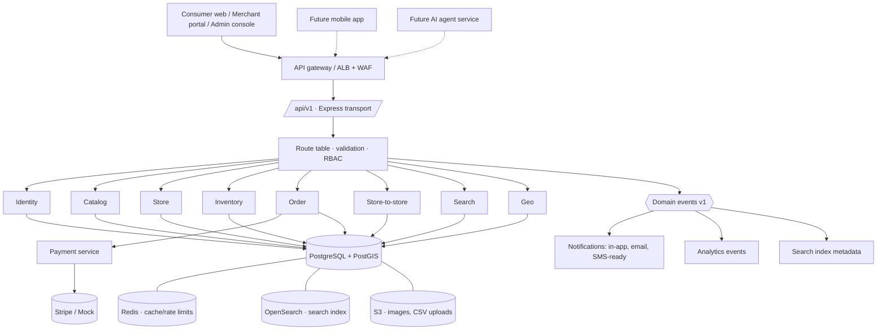

# Architecture

## Principles

- **API-first, one rule book.** Every business function is an entry in the route table (`packages/core/src/routes.ts`) with its validation schema and required permission. Transports (Express, browser demo, future mobile/AI gateways) only adapt HTTP; they never re-implement rules.
- **Ports and adapters.** Persistence (`DataStore`), payments (`PaymentProvider`), geocoding (`GeocodingProvider`), messaging (`MessageChannel`), events (`EventBus`) and maps (`MapView` providers) are interfaces with swappable implementations.
- **Modular monolith, service-shaped.** Services are separated by domain (identity, catalog, store, inventory, search, geo, order, store-order, payment, notification, admin, analytics) and communicate through the data store and domain events, so any module can be extracted into its own deployable later without changing callers.
- **Location-first data.** Stores carry PostGIS `geography(Point)` columns with GiST indexes; radius queries use `ST_DWithin` and distances `ST_Distance`.

## High-level architecture



## Request lifecycle

1. Express adds security headers (Helmet CSP, HSTS via ALB), CORS allow-list, request id, structured logging with secret redaction, and a per-route rate limit (`auth`, `write`, `default`).
2. `dispatch()` matches the route, authenticates the bearer JWT (session must be un-revoked and user active), checks the route's permission, requires `Idempotency-Key` where declared, validates query/body with Zod, and calls the service.
3. Services enforce store-level scoping (`assertStoreAccess`) including per-employee capabilities, write audit records for sensitive actions, and publish versioned domain events.
4. Errors use one envelope: `{ error: { code, message, details }, requestId }` with stable HTTP codes (401, 403, 404, 409, 402, 422, 423, 429).

## Key workflows

### Consumer checkout
```
Cart → Address / pickup → Store validation → Inventory validation → Price validation (expected total)
     → Taxes / fees → Payment authorization → Order confirmation → Store processing
     → Ready / Out for delivery (payment captured) → Completed
```
Stock is reserved atomically in the same transaction that creates the order (`UPDATE … WHERE quantity >= n`). A declined card releases the reservation. Replays with the same `Idempotency-Key` return the original order.

### Store-to-store (B2B) — separate tables and lifecycle
```
Draft → Submitted → Pending acceptance → Accepted (qty adjust / partial) → Preparing
      → Ready (stock leaves seller) → Completed (stock received by buyer)
      ↘ Rejected / Cancelled
```
Actor rules (buyer vs. seller) are enforced in `lifecycle.ts`.

## Search

Phase 1 search runs in PostgreSQL: exact SKU/UPC/store-SKU match, full-text (`tsvector`), and `pg_trgm` word similarity for partial and typo-tolerant matching, combined with PostGIS radius filtering and relevance/distance/price sorting. A small synonym map and filler-word cleanup normalise shopper phrasing; `"… within 5 miles"` and `"… in Dallas, Texas"` are parsed into radius and place.

`search_index_metadata` tracks indexed entity versions and is kept current by `product.upserted` / `store.status_changed` events, so an OpenSearch adapter can be introduced behind the same `/search` endpoint without schema changes. No AI is used in Phase 1 search; the endpoint is the seam for Phase 2 semantic and natural-language search.

## Maps

`MapView` selects a provider from configuration:
- `schematic` — offline SVG vector map (Web Mercator, pan/zoom, clustering, radius rings, keyboard-focusable markers). Used by the demo and restricted environments.
- `leaflet` — OpenStreetMap tiles via Leaflet (lazy-loaded). Mapbox/Google adapters implement the same props.

Every map has a list or table alternative on the same page.

## Configuration

Twelve-factor environment variables validated at startup (`apps/api/src/config.ts`). Production refuses to start with a development JWT secret or a Stripe provider without a key.
