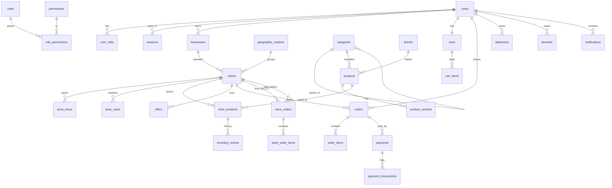

# Data model

Normalized PostgreSQL schema (`apps/api/db/migrations/001_init.sql`). Conventions: UUID primary keys generated by the application, integer cents for money, `timestamptz` created/updated timestamps, CHECK constraints for enumerations and ranges, soft delete (`deleted_at`) on users, stores and products, and an append-only `audit_logs` table enforced by trigger.

## Catalog vs. inventory

`products` is the shared catalog (brand, SKU, UPC, size, structured `attributes` JSON, variants, status). `store_products` is the store-specific layer: price, promotional price, quantity, low-stock threshold, min/max order quantity, visibility, availability dates, store SKU, source (manual, csv, bulk, admin, pos) and wholesale (B2B) terms. This separation answers "where can I find this item?" across stores:

| Store | Classic Cola 20 fl oz | Stock |
|---|---|---|
| Bluebonnet Fuel & Go | $2.29 | 15 |
| Trinity Fresh Express | $1.99 | 43 |
| White Rock Quick Stop | $2.49 | 7 |

## Geography

`stores.location` and `geographic_markets.center` are generated `geography(Point, 4326)` columns with GiST indexes. Stores also store address, city, county, state, ZIP (validated), service radius and market. Radius search: `ST_DWithin(location, point, miles × 1609.344)`.

## Orders

Consumer orders (`orders`, `order_items`) and store-to-store orders (`store_orders`, `store_order_items`) are separate tables so B2B can evolve independently (net terms, invoicing, logistics). `order_status_history` records every transition for both, distinguished by `kind`.

## Payments

`payments` holds provider, provider reference, status, amount, refunded amount, card brand and last four digits. No card numbers or CVCs are ever stored. `payment_transactions` logs authorize, capture, refund, void and failure events for reconciliation.

## Analytics and AI readiness

`analytics_events` (name, `schema_version`, user, store, JSON props), `search_events` (query, coarse ~1 km location, radius, result count) and `inventory_events` (every stock change with source and actor) are retained so Phase 2 recommendation, forecasting and agent services can consume history without redesigning the core schema.

## Indexes worth knowing

- `stores_location_gix` (GiST) — proximity queries
- `products_name_trgm`, `stores_name_trgm` (GIN trigram) — partial/typo search
- `products_search_idx` (GIN tsvector) — full-text
- `store_products_uq (store_id, product_id, variant_id)` — one listing per product per store
- `orders_idem_uq (user_id, idempotency_key)` — checkout replay safety
