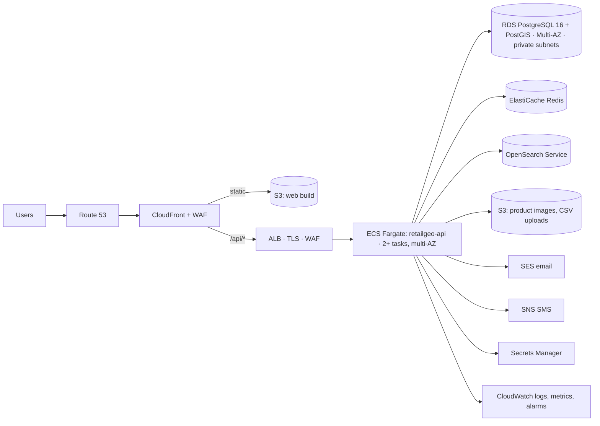

# AWS deployment

| Concern | Service | Notes |
|---|---|---|
| Compute | ECS Fargate (EKS optional later) | API image from `apps/api/Dockerfile`, health check `/health`, readiness `/ready`, graceful SIGTERM shutdown |
| Database | RDS PostgreSQL 16 with PostGIS | Multi-AZ, private subnets, encryption at rest, automated backups + PITR, `rds.force_ssl=1` |
| Cache / rate limits | ElastiCache Redis | Shared rate-limit store and hot-query cache when running >1 API task |
| Search | OpenSearch Service | Adapter behind `/search`; Postgres search remains the fallback |
| Static web | S3 + CloudFront | `apps/web/Dockerfile` also available for container hosting |
| Objects | S3 | Pre-signed uploads for product images and CSV files |
| Secrets | Secrets Manager / SSM | `JWT_SECRET`, `DATABASE_URL`, `STRIPE_SECRET_KEY`, `MAPBOX_TOKEN` |
| Edge security | WAF | AWS managed rule groups + rate-based rules on `/api/v1/auth/*` |
| Notifications | SES, SNS | Implement `MessageChannel` adapters |
| Observability | CloudWatch | JSON logs (pino), alarms on 5xx rate, p95 latency, DB CPU/connections, failed payments |

## Environments
`dev` → `staging` → `production`, each in its own account or VPC. Migrations run as a one-off ECS task (`node dist/migrate.js`) before the service update. Production deploys use blue/green (CodeDeploy) behind the protected GitHub environment (QA approval).

## Disaster recovery
RPO ≤ 5 min (PITR), RTO ≤ 1 h. Quarterly restore drill into staging. Infrastructure is declared as code (Terraform/CDK) so an environment can be rebuilt from source.
